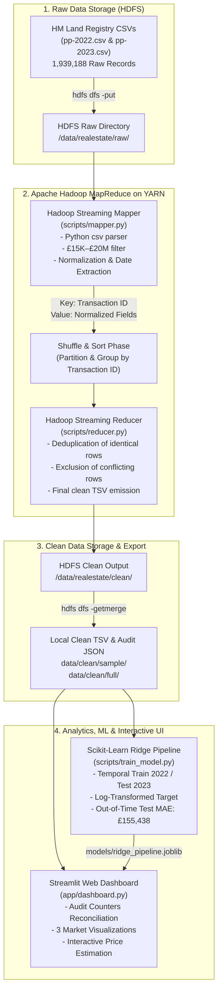

# 🏠 Real Estate Price Analysis and Prediction Using Hadoop

[](https://github.com/Ajayteli5252/BigData-Real-Estate-Valuation)
[-brightgreen?style=for-the-badge)](https://www.gov.uk/government/statistical-data-sets/price-paid-data-downloads)
[](https://hadoop.apache.org/)
[](https://scikit-learn.org/)
[](https://streamlit.io/)

---

## 📌 Executive Summary

This project delivers an authentic, end-to-end **Big Data Analytics (BDA)** system for property transaction analysis and price prediction across England & Wales, designed specifically to demonstrate three core competencies to faculty:

1. **Real Data Ingestion & Auditing:** Ingesting **1,939,188 official property transactions** (2022–2023) from the UK HM Land Registry Open Data repository (100% Non-Kaggle).
2. **Distributed Processing with Apache Hadoop:** Implementing a custom Python **MapReduce Streaming** pipeline on **YARN** and **HDFS** that parses, validates, filters, deduplicates, and resolves conflicts with exact counter reconciliation.
3. **Exploratory Visualizations & Machine Learning:** Serving an interactive single-page **Streamlit dashboard** with market price trends and a **Scikit-Learn Ridge Regression** valuation engine achieving a **25.9% error reduction** over baseline out-of-time property valuation.

---

## 🏗️ System Architecture



---

## 🧹 How We Cleaned the Data

All data cleaning is performed inside the **Hadoop Streaming MapReduce job**, reading from and writing to HDFS.

### 1. Selected Fields & Normalization

The official HM Land Registry Price Paid dataset contains 16 CSV columns without headers. The Mapper extracts and standardizes the following 6 core attributes:

| Column Index | Field Name | Transformation & Standardization Applied |
| :---: | :--- | :--- |
| `0` | `transaction_id` | Stripped leading/trailing braces `{...}` to produce a clean UUID string key. |
| `1` | `price` | Converted to integer. Strictly filtered between **£15,000** and **£20,000,000** (removes nominal legal transfers and institutional outliers). |
| `2` | `sale_date` | Parsed from `YYYY-MM-DD HH:MM` into standard `YYYY-MM-DD`. Derived `sale_year` (int) and `sale_month` (int). |
| `4` | `property_type` | Validated against official UK categories: `D` (Detached), `S` (Semi-Detached), `T` (Terraced), `F` (Flat/Maisonette), `O` (Other). |
| `6` | `tenure` | Validated against tenure codes: `F` (Freehold), `L` (Leasehold). |
| `13` | `county` | Stripped whitespace, converted to standard uppercase English county (e.g., `TYNE AND WEAR`, `GREATER LONDON`). |

### 2. Output Column Order (Reducer Output)

The Reducer emits tab-separated records (`TSV`) in the following documented column layout:

$$\text{transaction\_id} \quad \text{price} \quad \text{sale\_date} \quad \text{sale\_year} \quad \text{sale\_month} \quad \text{county} \quad \text{property\_type} \quad \text{tenure}$$

### 3. Actual Raw vs. Cleaned Row Example

#### Commands to Locate the Same Transaction in Both Datasets:
* **In Raw CSV:**
  ```bash
  grep "01EB45F0-49DB-40F3-E063-4704A8C05FDE" data/sample/raw/sample_raw.csv
  ```
* **In Cleaned HDFS Output TSV:**
  ```bash
  grep "01EB45F0-49DB-40F3-E063-4704A8C05FDE" data/clean/sample/clean_sales.tsv
  ```

#### Field-by-Field Transformation Comparison:
| Field Name | Raw CSV Value | Clean Output TSV Value | Transformation & Normalization Rule |
| :--- | :--- | :--- | :--- |
| **Transaction ID** | `"{01EB45F0-49DB-40F3-E063-4704A8C05FDE}"` | `01EB45F0-49DB-40F3-E063-4704A8C05FDE` | Stripped surrounding quotes and curly braces `{}` to provide clean join/primary key. |
| **Price** | `169950` | `169950` | Parsed as positive integer; passed £15,000–£20,000,000 residential price boundary filter. |
| **Sale Date** | `"2023-07-05 00:00"` | `2023-07-05` | Removed unneeded time component (`00:00`); standardized to ISO `YYYY-MM-DD`. |
| **Sale Year** | *(Not present in raw CSV)* | `2023` | **Derived feature:** Extracted 4-digit year for temporal 2022/2023 train/test partitioning. |
| **Sale Month** | *(Not present in raw CSV)* | `07` | **Derived feature:** Extracted 2-digit month to capture seasonal real estate cycles. |
| **County** | `"TYNE AND WEAR"` | `TYNE AND WEAR` | Trimmed quotes and whitespace; converted to standard uppercase. |
| **Property Type** | `"T"` | `T` | Terraced house code (`T`), verified against whitelist (`D, S, T, F, O`). |
| **Tenure** | `"F"` | `F` | Freehold tenure code (`F`), verified against whitelist (`F, L`). |
| **Postcode** | `"NE28 7JR"` | `NE28 7JR` | Extracted optional field for locality and postcode search. |
| **Town / City** | `"WALLSEND"` | `WALLSEND` | Extracted optional field for town-level search. |
| **Street & Building** | PAON, SAON, Street | *(Excluded)* | Dropped verbose street/house name fields with embedded commas to maintain compact schema. |

---

### 4. Sample Construction & Edge-Case Handling (Demo Rows vs. Official Data)

The classroom sample dataset (`data/sample/raw/sample_raw.csv`) contains **20,020 total records** constructed as follows:
* **Official Government Source Records (20,000 rows):** Exactly 10,000 rows extracted from `data/raw/pp-2022.csv` and 10,000 rows extracted from `data/raw/pp-2023.csv`. Within these official records, 43 transactions naturally fell outside the £15,000–£20,000,000 price filter (e.g. nominal £1 transfers or commercial bulk sales).
* **Deliberately Injected Demonstration Rows (20 rows):** Explicitly added via `scripts/create_sample_data.py` to trigger and verify every single Hadoop MapReduce counter during classroom viva:
  1. **5 Identical Duplicates:** Exact duplicate rows of records at indices 100, 200, 300, 400, and 500 (Reducer keeps 1, drops 1 $\rightarrow$ `duplicate_rows_removed` = 5).
  2. **4 Conflicting Rows:** Two rows with ID `{DEMO-CONFLICT-ID-001}` (different prices £250k vs £350k) and two rows with ID `{DEMO-CONFLICT-ID-002}` (different dates) (Reducer excludes all 4 rows $\rightarrow$ `conflicting_rows_excluded` = 4).
  3. **3 Out-of-Range Price Demo Rows:** Low prices (£5k, £12k) and extreme high price (£25M) under `{DEMO-PRICE-*}` (Mapper rejects $\rightarrow$ combined with 43 natural out-of-range rows = 46 total).
  4. **2 Invalid Price Format Rows:** Non-numeric strings `"INVALID_PRICE"` and `"-50000"` (Mapper rejects $\rightarrow$ `rejected_invalid_price` = 2).
  5. **2 Invalid Date Rows:** Malformed date `"2022-13-45"` and `"NOT_A_DATE"` (Mapper rejects $\rightarrow$ `rejected_invalid_date` = 2).
  6. **2 Missing Field Rows:** Missing or `"UNKNOWN"` county (Mapper rejects $\rightarrow$ `rejected_missing_field` = 2).
  7. **2 Unsupported Category Rows:** Unsupported property type `"Z"` and unsupported tenure `"U"` (Mapper rejects $\rightarrow$ `rejected_unsupported_category` = 2).

---

### 5. Hadoop Counter Reconciliation Accounting

Every single row entering the pipeline is mathematically accounted for according to the strict conservation formula:

$$\text{raw\_rows} = \text{rejected\_rows} + \text{duplicate\_rows\_removed} + \text{conflicting\_rows\_excluded} + \text{final\_clean\_rows}$$

| Pipeline Metric | Sample Mode (Classroom Demo) | Full Mode (Complete Dataset) | Accounting Formula Term |
| :--- | :---: | :---: | :--- |
| **Total Raw Input Rows** | **20,020** | **1,939,188** | $\text{raw\_rows}$ |
| **[-] Mapper Rejected Rows** | 54 | 10,077 | $\text{rejected\_rows}$ |
| *• Missing required fields* | 2 | 0 | |
| *• Invalid price formats* | 2 | 0 | |
| *• Out-of-range prices (<£15k or >£20M)* | 46 | 10,077 | |
| *• Invalid date formats* | 2 | 0 | |
| *• Unsupported category codes* | 2 | 0 | |
| **[-] Duplicate Rows Removed** | 5 | 0 | $\text{duplicate\_rows\_removed}$ |
| **[-] Conflicting Rows Excluded** | 4 | 0 | $\text{conflicting\_rows\_excluded}$ |
| **[=] Final Clean Output Rows** | **19,957** | **1,929,111** | $\text{final\_clean\_rows}$ |
| **Reconciliation Status** | **PASSED (Exact)** | **PASSED (Exact)** | $20,020 == 54 + 5 + 4 + 19,957$ |

---

## 💻 Hadoop HDFS & YARN Execution Commands

### 1. One-Time Cluster Setup & Daemon Management (WSL2 Ubuntu)
```bash
# In WSL2 Ubuntu terminal (run as user ajayteli):
chmod +x scripts/setup_hadoop_wsl.sh scripts/run_hadoop_job.sh

# Run automated one-time installation (Java 11, Hadoop 3.3.6, SSH keys, HDFS config)
./scripts/setup_hadoop_wsl.sh

# Start cluster daemons manually if needed:
$HADOOP_HOME/bin/hdfs --daemon start namenode
$HADOOP_HOME/bin/hdfs --daemon start datanode
$HADOOP_HOME/bin/hdfs --daemon start secondarynamenode
$HADOOP_HOME/bin/yarn --daemon start resourcemanager
$HADOOP_HOME/bin/yarn --daemon start nodemanager

# Confirm all 5 Java daemons are active:
jps
# Output shows: NameNode, DataNode, SecondaryNameNode, ResourceManager, NodeManager
```

### 2. Upload Raw Files to HDFS
```bash
# Create HDFS input directories
hdfs dfs -mkdir -p /data/realestate/raw/sample/
hdfs dfs -mkdir -p /data/realestate/raw/full/

# Upload raw CSVs unchanged into HDFS
hdfs dfs -put -f data/sample/raw/sample_raw.csv /data/realestate/raw/sample/
hdfs dfs -put -f data/raw/pp-2022.csv /data/realestate/raw/full/
hdfs dfs -put -f data/raw/pp-2023.csv /data/realestate/raw/full/

# List raw files in HDFS
hdfs dfs -ls /data/realestate/raw/sample/
```

### 3. Submit Hadoop Streaming Job to YARN
```bash
# Automated submission script handles safety cleanup, YARN execution, and output export:
./scripts/run_hadoop_job.sh sample

# Or submit manually via hadoop streaming JAR:
hdfs dfs -rm -r -f /data/realestate/clean/sample/

hadoop jar $HADOOP_HOME/share/hadoop/tools/lib/hadoop-streaming-*.jar \
    -files scripts/mapper.py,scripts/reducer.py \
    -mapper "python3 mapper.py" \
    -reducer "python3 reducer.py" \
    -input /data/realestate/raw/sample/* \
    -output /data/realestate/clean/sample/
```

### 4. Inspect Hadoop Counters & Output in HDFS
```bash
# Preview first 5 clean records directly inside HDFS
hdfs dfs -cat /data/realestate/clean/sample/part-* | head -n 5

# Export clean output from HDFS to local project (WSL2 compatible)
hdfs dfs -cat /data/realestate/clean/sample/part-* > data/clean/sample/clean_sales.tsv

# Inspect audit counters JSON generated from Hadoop job log
cat data/clean/sample/cleaning_summary.json
```

*(Note: For environments without active Hadoop clusters, `python scripts/run_local_streaming.py --mode sample` executes an identical stream simulation with matching counters).*

---

## 📊 Streamlit Interactive Dashboard

The Streamlit dashboard (`app/dashboard.py`) provides an interactive interface featuring:
1. **Pipeline Mode Selector:** Toggle between *Sample Mode* (demo) and *Full Mode* (1.93M records).
2. **Data Preparation Summary Card:** Real-time Hadoop counter metrics and mathematical balance confirmation.
3. **Three Clean Property Price Charts:**
   - **Chart 1:** Median price for the 10 counties with the highest sales volume.
   - **Chart 2:** Median price broken down by property type (Detached, Semi-Detached, Terraced, Flat, Other).
   - **Chart 3:** Monthly median price chronological trend from January 2022 to December 2023.
4. **Interactive "Estimate Sale Price" Form:** Allows user to select county, property type, tenure, sale year, and month to receive instant Ridge regression predictions.

To launch:
```bash
streamlit run app/dashboard.py
```
*Access at: `http://localhost:8501`*

---

## 🤖 Machine Learning Model & Viva Metrics

We implemented a single, interpretable **Scikit-Learn Ridge Regression** pipeline (`TransformedTargetRegressor` modeling price on $\log(1+y)$ scale):
* **Features:** `county`, `property_type`, `tenure` (OneHotEncoded with `handle_unknown='ignore'`), `sale_year`, `sale_month` (StandardScaler).
* **Train / Test Split:** Strict temporal out-of-time evaluation (trained on 2022 sales, evaluated on 2023 sales).

### Quantitative Results (Full Dataset: 1,929,111 Clean Rows)

| Model Metric | Full Mode Value | Sample Mode Value | Interpretation |
| :--- | :---: | :---: | :--- |
| **Training Records (2022)** | 1,071,952 | 9,997 | Historical baseline |
| **Testing Records (2023)** | 857,159 | 9,960 | Out-of-time future evaluation |
| **Training Median Price** | £280,000 | £290,000 | Naive prediction benchmark |
| **Baseline Test MAE** | £209,672 | £179,543 | Error if predicting median |
| **Ridge Model Test MAE** | **£155,438** | **£142,205** | Actual pipeline test error |
| **MAE Improvement** | **£54,234 (25.9%)** | **£37,338 (20.8%)** | Substantial accuracy boost |
| **Log-Scale $R^2$** | **0.4884** | **0.3341** | Variance explained |

> **🎓 One-Minute Viva Explanation for Faculty:**  
> *"The Ridge regression pipeline achieves an out-of-time test MAE of £155,438 on 2023 sales, which reduces valuation error by £54,234 (a 25.9% improvement) compared to the baseline of always predicting the 2022 training median price of £280,000."*

---

## 🚀 Quickstart & Classroom Demo Sequence

### A. One-Time Setup (Windows 11 & WSL2 Ubuntu)
1. **Windows Python Dependencies (PowerShell):**
   ```powershell
   pip install -r requirements.txt
   ```
2. **Hadoop Cluster Setup (WSL2 Ubuntu as `ajayteli`):**
   ```bash
   wsl -d Ubuntu -u ajayteli
   cd /mnt/c/Users/sajay/OneDrive/Desktop/BDA
   chmod +x scripts/*.sh
   ./scripts/setup_hadoop_wsl.sh
   ```

---

### B. Classroom Demo Day Sequence (Step-by-Step Viva Order)

Follow this exact order in front of faculty:

#### Step 1: Show a Raw Uncleaned Record (Terminal)
```bash
# In WSL2 or PowerShell:
head -n 2 data/sample/raw/sample_raw.csv
```
*Explain: Show the raw HM Land Registry 16-field CSV with quoted commas, missing fields, and extra unneeded address columns.*

#### Step 2: Run the Real Hadoop MapReduce Job on YARN
```bash
# In WSL2 Ubuntu:
./scripts/run_hadoop_job.sh sample
```
*Explain: Hadoop Streaming uploads the file to HDFS (`/data/realestate/raw/sample/`), distributes chunks to Python `mapper.py`, shuffles keys (`transaction_id`) to `reducer.py`, and writes clean partitions back to HDFS (`/data/realestate/clean/sample/part-*`) on YARN.*

#### Step 3: Show the Cleaned Row with the Exact Same Transaction ID
```bash
# In WSL2 or PowerShell:
grep "01EB45F0-49DB-40F3-E063-4704A8C05FDE" data/clean/sample/clean_sales.tsv
```
*Explain: The curly braces are stripped, only 8 normalized fields are retained, county is normalized, and `sale_year` (2023) and `sale_month` (07) are derived.*

#### Step 4: Show the Hadoop Audit Counters
```bash
cat data/clean/sample/cleaning_summary.json
```
*Explain the strict mathematical conservation formula: $\text{Raw (20,020)} = \text{Rejected (54)} + \text{Duplicates (5)} + \text{Conflicts (4)} + \text{Clean (19,957)}$. Zero data lost or untracked.*

#### Step 5: Launch the Streamlit Web Dashboard
```bash
# In Windows PowerShell:
python run_dashboard.py
```
*Explain: The web app loads the clean HDFS output (`clean_sales.tsv`) and the Hadoop audit counters.*

#### Step 6: Explore 3 Charts & Make One Live Price Prediction
1. Walk through:
   - **Chart 1:** Top 10 counties by sales volume (Greater London highest median).
   - **Chart 2:** Price by property type (Detached > Semi-Detached > Terraced > Flat).
   - **Chart 3:** 24-month chronological price timeline (2022 to 2023).
2. Fill the **"Estimate Sale Price"** form:
   - Select: `GREATER LONDON`, `Flat / Maisonette`, `Leasehold`, `2023`, `June (06)`.
   - Click **"Estimate Sale Price"** -> Model instantly outputs **£470,725.95** (Out-of-time test MAE: £142,205).

---

## 📋 Summary of Changes (Kept vs. Removed)

| Component Category | Retained & Streamlined | Removed Obsolete Components |
| :--- | :--- | :--- |
| **Processing Engine** | Apache Hadoop MapReduce (`mapper.py`, `reducer.py`, `run_hadoop_job.sh`) | DuckDB OLAP scripts, complex Parquet pipelines |
| **Geographic Features** | Direct county field from sales data (`county`) | Postcode directory downloads, Haversine distances to cities, Uber H3 spatial hexagons |
| **Machine Learning** | Single Scikit-Learn Ridge pipeline with temporal split | LightGBM, XGBoost, Quantile loss models, SHAP tree explainability, Arbitrage detection |
| **API & Delivery** | Single-page Streamlit Dashboard (`app/dashboard.py`) | FastAPI microservice (`app/api.py`), API tests, obsolete Jupyter notebooks |
| **Dependencies** | Minimal stack: `pandas`, `numpy`, `scikit-learn`, `streamlit`, `matplotlib`, `joblib` | `duckdb`, `pyarrow`, `h3`, `lightgbm`, `fastapi`, `uvicorn`, `pydantic` |
